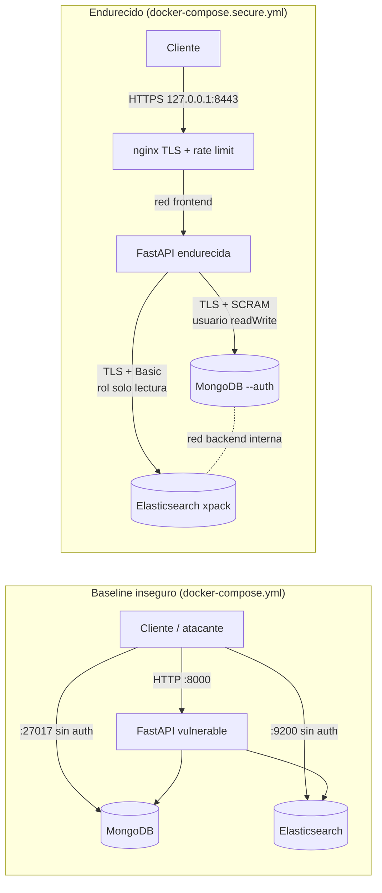

# Laboratorio de seguridad NoSQL · MongoDB + Elasticsearch + FastAPI


Laboratorio reproducible de la **Actividad 1 de Seguridad en Bases de Datos, Blockchain y Big Data (UNIR)**.
Levanta un escenario **inseguro por defecto**, lo **ataca de forma controlada**, aplica **contramedidas** y
**verifica** que los mismos ataques fallan (401/403/422/429) y quedan registrados.

> ⚠️ **Solo laboratorio.** Los scripts de ataque están fijados a `localhost` y al dataset de prueba.
> No los ejecutes contra sistemas que no sean tuyos.

## Arquitectura



| | Baseline inseguro | Endurecido |
|---|---|---|
| Puertos en el host | 8000, 9200, 27017 en `0.0.0.0` | solo `127.0.0.1:8443` (TLS) |
| MongoDB | sin `--auth`, sin TLS | `--auth`, `requireTLS`, usuario `readWrite` solo en `tienda`, `$jsonSchema` |
| Elasticsearch | `xpack.security.enabled=false` | seguridad + TLS HTTP, usuario `api_lector` con rol de solo lectura |
| Login | JSON crudo a `find_one` (NoSQLi), contraseñas en claro | Pydantic estricto, filtro de `$`, bcrypt, JWT 15 min |
| Búsqueda | `q` → Lucene `query_string`, sin paginar | `multi_match`, patrón y longitud, `size ≤ 20`, campos limitados |
| Autorización | ninguna | RBAC: cada cliente ve lo suyo, solo `admin` borra |
| Logging | accesos HTTP sin identidad | JSON de seguridad + alertas (fuerza bruta, picos de búsqueda) |
| Otros | — | rate limit (nginx + slowapi), backups, contenedor *read-only* y sin capacidades |

## Requisitos

- Docker Desktop con Docker Compose v2 (asigna al menos 4 GB de RAM).
- `curl`, `openssl` y Python 3 en el host. Opcionales: `mongosh`, `jq`, `nmap`.
- macOS o Linux. En Windows, ejecuta los scripts desde **Git Bash** o **WSL**.

## Puesta en marcha

### Fase 1 · Baseline inseguro
```bash
docker compose up -d --build        # mongo, elasticsearch, es-init, fastapi-app
docker compose ps                   # esperar a que todo esté "healthy"/"exited (0)"
./scripts/00_smoke_test.sh          # servicios, datos y CRUD funcionando
```

### Fase 2 · Reconocimiento
```bash
./scripts/01_recon.sh               # puertos, ausencia de auth/TLS, privilegios, logging
```

### Fase 3 · Ataques controlados
```bash
./scripts/02_attacks.sh             # NoSQLi, Mongo anónimo (lectura/escritura), ES abierto, DELETE
docker compose down -v              # apagar el baseline al terminar
```

### Fases 4-5 · Defensa mínima y endurecimiento ampliado
```bash
./scripts/gen_certs.sh              # CA de laboratorio + certificados api/mongo/elasticsearch
./scripts/gen_env.sh                # .env con secretos aleatorios (no se sube a Git)
docker compose -f docker-compose.secure.yml up -d --build
docker compose -f docker-compose.secure.yml ps
```

### Fase 6 · Verificación
```bash
./scripts/03_verify_secure.sh       # repite los ataques: todos deben fallar y quedar registrados
./scripts/04_backups.sh             # mongodump por TLS + snapshot de Elasticsearch
```

Cada script imprime fecha, comando y resultado, y guarda una copia en `evidencias/`.
`03_verify_secure.sh` termina con una tabla PASS/FAIL y la guarda en `evidencias/03_verify_resumen_*.txt`.

### Credenciales del laboratorio

| Escenario | Usuarios de la tienda |
|---|---|
| Inseguro | `alice / alice123`, `bob / bob123`, `admin / S3cr3t!` (en claro, a propósito) |
| Endurecido | `alice / Alice#2026lab`, `bob / Bob#2026lab`, `admin / Adm1n#2026lab` (bcrypt) |

Las credenciales de servicio (root de Mongo, usuario de app, `elastic`, `api_lector`, secreto JWT) se generan
al azar en `.env`.

## Ataques, contramedidas y verificación

| Ataque (02_attacks.sh) | Contramedida | Resultado esperado (03_verify_secure.sh) |
|---|---|---|
| A1-A3 NoSQLi `$ne`, `$regex`, `$gt` en `/login_mongo` | Pydantic estricto + filtro global de claves `$`/`.` + consulta solo por `username` y bcrypt | **422** y evento `nosqli_blocked` |
| A4 lectura anónima de Mongo desde el host | Puerto no publicado, `--auth`, TLS obligatorio | puerto **cerrado**; dentro de la red: *requires authentication* |
| A5 escritura anónima (alta de admin) | Igual que A4 + usuario app sin `userAdmin` + `$jsonSchema` | *not authorized* / *Document failed validation* |
| A6-A7 `_cat/indices`, `_search?q=*` | ES no expuesto, `xpack.security` + TLS, rol de solo lectura | puerto **cerrado**; anónimo **401**; `api_lector` **403** en `_cat` |
| A8 sintaxis Lucene vía API (`coste_interno:>500`) | `multi_match`, patrón de búsqueda, `_source` limitado | **422**; la respuesta no contiene `coste_interno` |
| A9 `DELETE /articulos` | Rol sin privilegio de borrado | **403** |
| Fuerza bruta / abuso de búsqueda | Rate limit (nginx + slowapi) + alertas | **429** y eventos `ALERTA_*` |

## Relación con Zero Trust, mínimo privilegio y normativa

- **Zero Trust:** ninguna petición se da por buena por venir de la red interna. Cada salto autentica (JWT, SCRAM,
  Basic sobre TLS) y se cifra; cada entrada se valida.
- **Mínimo privilegio:** usuario Mongo `readWrite` solo en `tienda`; usuario ES con `read` solo en `articulos`;
  RBAC en la API; contenedor sin root, *read-only* y sin capacidades.
- **RGPD art. 25 y 32:** protección desde el diseño, cifrado en tránsito, contraseñas con bcrypt, minimización de
  campos devueltos, copias de seguridad y registro de accesos.
- **NIS2 art. 21:** gestión de incidentes (logs y alertas), continuidad (backups), seguridad de la cadena de
  suministro (dependencias auditadas en CI) y cifrado.

## Estructura

```
├── docker-compose.yml           # baseline inseguro
├── docker-compose.secure.yml    # escenario endurecido
├── init_mongo.js                # datos del baseline
├── init_elastic.sh              # índice articulos (+ RBAC en el endurecido)
├── secure/
│   ├── init_mongo_secure.js     # usuario de app, bcrypt, $jsonSchema
│   └── nginx.conf               # TLS, cabeceras, rate limit
├── fastapi-app/
│   ├── Dockerfile               # Python 3.11, usuario sin privilegios
│   ├── requirements.txt         # versiones fijadas y auditadas
│   └── app/{main_vulnerable,main_secure}.py
├── scripts/                     # 00-04 por fases, gen_certs, gen_env
├── tests/                       # pytest: el baseline es explotable y la versión segura no
├── evidencias/                  # salidas fechadas de los scripts
└── .github/workflows/ci.yml     # tests, Bandit, pip-audit, ShellCheck, compose config
```

## Integración continua

Cada push ejecuta en GitHub Actions: 21 pruebas automáticas, análisis estático (Bandit), auditoría de CVE de
dependencias (pip-audit), lint de scripts (ShellCheck) y validación de los dos `docker-compose`.

## Problemas habituales

- **Elasticsearch se reinicia:** sube la memoria de Docker Desktop (4 GB o más).
- **Apple Silicon:** todas las imágenes tienen versión arm64.
- **Cambié `.env` después de arrancar:** los usuarios se crean solo la primera vez; haz
  `docker compose -f docker-compose.secure.yml down -v` y vuelve a levantar.
- **Windows:** usa Git Bash o WSL; si no existe `python3`, los scripts usan `python`.

## Autor

Alberto Alba Sánchez · Grado en Ciberseguridad (UNIR) · Seguridad en Bases de Datos, Blockchain y Big Data.
